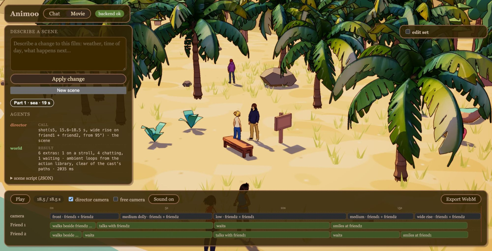

# Animoo

**3D props:** NVIDIA Nemotron → NVIDIA SANA-Sprint → TRELLIS.2 → three.js  
**Motion:** NVIDIA Nemotron → Llama-3-8B-Instruct (LLM2Vec, Kimodo's text encoder) → NVIDIA Kimodo → three.js  
*All generation runs on an NVIDIA Brev A100; Nemotron agents plan, build and direct every scene.*

**Type a sentence, get a living animated film.** A team of NVIDIA Nemotron agents plans the story,
builds the world and directs the characters like a game controller; specialist models generate
whatever is missing (3D props, motion, sound); and the film keeps changing while it plays when you
say "make it night" or "then they go inside".

Built for the **NVIDIA track: Use Nemotron beyond a chatbot** (HackUTD 2026).



## What it does

- **Prompt → film:** "At night in the rain a lamplighter walks down the village street, lights a
  lantern by the houses, and waves to a girl at her window." In about 10-25 s: a 3D storybook set,
  a cast in matching outfits, motion, camera work, ambient sound and music.
- **Directed like a game:** every beat is a command (who walks where, beside whom, who sits,
  waves, nods, shakes hands, leaves). Moves come from a motion library, like a game's animation
  set; text-to-motion runs only for moves outside it.
- **Live changes:** "make it night", "make it winter", "back to day" relight the running film in
  about 10 ms with no LLM call; "now they dance" revises just that with one Nemotron call.
- **Multi-part stories:** "then they go inside to their room and sit down" adds Part 2 with a new
  set and the same characters, played straight through.
- **Director camera:** rule-based editing: front and side tracking of walkers, over-the-shoulder for
  dialogue, no jump cuts.
- **Edit mode:** move, swap or regenerate props, draw camera and character paths.
- **Chat:** talk to Milo, a 3D character who answers with Nemotron, speaks with ElevenLabs and acts
  out the move you ask for.

## Architecture

```
 Browser: three.js (web/)  ◄── SSE: live agent log + scene script (JSON)
   │  director: clips, paths, facing, seats · camera: shots · toon look
   ▼
 FastAPI server (server/)  the hub: sends each model its input, checks what comes back
   ├── NVIDIA API ── Nemotron 3.5 Super / Lightning ── JSON plans and choices
   ├── SSH tunnel ── Brev A100 (gpu/)
   │      :8101 Kimodo            text → motion (BVH)
   │      :8102 TRELLIS.2         image → 3D (GLB)
   │      :8103 SANA-Sprint       text → concept image
   │      :8104 Nemotron Nano 9B  fallback LLM (vLLM)
   ├── ElevenLabs ── ambience loops, Milo's voice (MP3)
   └── library/ ── every generated asset cached with its prompt
```

### The pipeline for one prompt

1. **Orchestrator (Nemotron 3.5 Super):** scene → plan JSON: cast and looks, places, command beats
   (`{"do": "walk", "move_to": "shop", "beside": "guy1"}`), time, weather, sound prompt.
2. **Plan repair (code):** validates and fixes the plan: posture, sync (`after` / `with`), side-by-side
   walks, mutual gestures. Nemotron decides *what* happens; code decides exact coordinates and timing.
3. **World agent (Nemotron 3.5 Lightning + tools):** `search_library(place)` → picks props from the
   library, or calls `generate_prop(name, prompt, size_m)`.
4. **Prop generation (GPU):** prompt → **SANA-Sprint** concept image → **BiRefNet** background removal →
   **TRELLIS.2** textured mesh (GLB) → scaled to real size, toon-shaded, cached in `library/`.
5. **Layout (code):** plan + world → scene script with exact positions, walking paths and timing.
6. **Motion:** library clips (generated once with Kimodo) or **Kimodo** live for custom moves; BVH
   retargeted onto VRM characters with leg IK.
7. **Director + camera (browser):** joins clips, plans paths around props and people, cuts the shots.
8. **Revise:** follow-ups edit the cached plan by rule or with one Nemotron call; a new place becomes
   a new film part.

## Models

| Job | Model | Where |
|---|---|---|
| Orchestrator, revise | **Nemotron 3.5 Super** (`nvidia/nemotron-3.5-super-vl-120b-a12b`) | NVIDIA API (build.nvidia.com) |
| World agent, chat | **Nemotron 3.5 Lightning** (`nvidia/nemotron-3.5-lightning-30b-a3b`) | NVIDIA API |
| LLM fallback | **Nemotron Nano 9B v2** (`nvidia/NVIDIA-Nemotron-Nano-9B-v2`) | vLLM on the A100 |
| Text → motion | **Kimodo** SOMA-RP v1.2 (`nvidia/Kimodo-SOMA-RP-v1.2`; text encoder LLM2Vec on Llama-3-8B-Instruct) | A100 |
| Text → image | **SANA-Sprint 1.6B** (`Efficient-Large-Model/Sana_Sprint_1.6B_1024px_diffusers`) | A100 |
| Image → 3D | **TRELLIS.2-4B** (`microsoft/TRELLIS.2-4B`) + BiRefNet (`ZhengPeng7/BiRefNet`) | A100 |
| Sound | ElevenLabs sound effects and TTS | ElevenLabs API |

## GPU

One **NVIDIA Brev A100 SXM4 80 GB** hosts the generators: Kimodo (about 4 s per 5 s clip), SANA-Sprint
and TRELLIS.2 (a new prop in about 20-45 s), and the Nemotron Nano fallback. `gpu/setup.sh` builds the
box, `gpu/*_server.py` are the small FastAPI services in front of each model, and `gpu/tunnel.sh`
forwards them to the laptop. Everything generated is cached with its prompt, so the demo replays
without the GPU.

## Repo layout

```
server/        FastAPI app, the Nemotron client (llm.py), agents (agents/movie.py), tools (tools/)
web/           three.js front end, no build step: movie/ (director, camera, world), characters/, chat/
gpu/           GPU box setup and the model servers (motion, asset, image)
library/       props (GLB + manifest.json), characters (VRM), motion clips, cached films and audio
docs/          Devpost text and images
```

## Run

```bash
python3 -m venv server/.venv && server/.venv/bin/pip install -r server/requirements.txt
cp .env.example .env          # then add NVIDIA_API_KEY (and ELEVENLABS_API_KEY for sound)
server/.venv/bin/uvicorn server.app:app --port 8000   # serves web/ at http://localhost:8000
bash gpu/tunnel.sh            # in another terminal: the GPU servers on :8101-:8104
```

Cached films play without the GPU. `http://localhost:8000/?demo` runs a self-driving demo.

## Credits

VRM characters by SherryKatzu and Rarestgrass (VRoid, credit required). Props from Kenney (CC0) and
generated with SANA-Sprint + TRELLIS.2.
